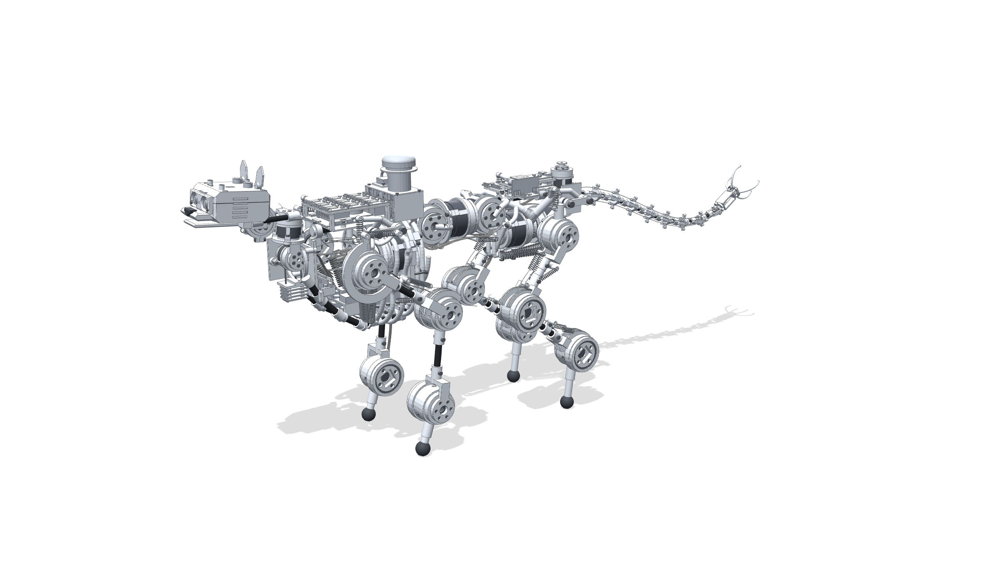

# BLUR in MuJoCo — physics tests of the 3D-printed cheetah

BLUR is a 3.7 kg, 26-actuator quadruped (the Arenda cheetah). This repo holds the MuJoCo twin generated from the kinematic rig and every physics experiment run against it: does the body as designed stand, walk, jump, bound and gallop on the motors and springs in the parts list?



**Demo:** [`demo/blur_motion_render.mp4`](demo/blur_motion_render.mp4) (CAD motion render) · [`demo/mujoco_sim_recording_1.mp4`](demo/mujoco_sim_recording_1.mp4), [`demo/mujoco_sim_recording_2.mp4`](demo/mujoco_sim_recording_2.mp4) (the MuJoCo twin on screen).

| folder | what |
|---|---|
| `blur_mujoco/` | v35 model: `blur.xml`, 6 scenes, meshes, `moves.npz`, `replay.py` |
| `blur_mujoco_v36/` | v36 model (direct-drive spine, 4 N·m wrists, jump springs) + `physics_checks.py` |
| `baseline/`, `baseline_v36/` | the shipped reports and our byte-identical reruns |
| `experiments/` | v35: wrist/torque variants (`make_variants.py`, `run_all.sh`) → [`RESULTS.md`](RESULTS.md) |
| `experiments_v36/` | v36: jump-spring sweep + bounding-gait spine test → [`RESULTS_v36.md`](RESULTS_v36.md) |

## Run it

```bash
python -m venv .venv && source .venv/bin/activate
pip install mujoco numpy scipy matplotlib
cd blur_mujoco_v36
python replay.py                               # BLUR standing on its own motors (macOS: mjpython)
python replay.py --move gallop --kinematic     # the rig's gallop animation, no physics
python replay.py --report                      # reproduces report.json
python physics_checks.py                       # speed / walk / jump / hold numbers
python -m mujoco.viewer --mjcf scene_flat.xml  # plain viewer
```

## Headline results

- v35: upgrading the wrists alone changes nothing that matters (`RESULTS.md`).
- v36: the stiffest jump spring that still lets the leg extend is ~1.7 N·m at the crouch; the bound needs 6.6–11 N·m at spine S1 against the 3.8 N·m fitted, so **the spine, not the legs, caps the gallop** (`RESULTS_v36.md`).

Related: the BrAInOS bring-up that inhabits this twin lives in [ArjunParadkar/BrAINOS](https://github.com/ArjunParadkar/BrAINOS) under `blur/` and `os/blur/`; the printed parts and CAD are in the BLUR_final design package.
